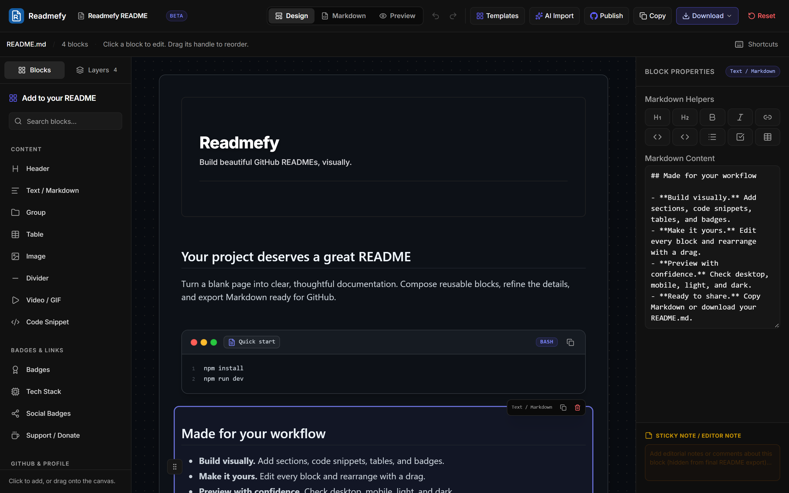

<div align="center">

# Readmefy

**Build beautiful GitHub READMEs, visually.**

Drag-and-drop blocks, a live GitHub-accurate preview, AI auto-fill, and one-click push to your repo — without writing raw markdown.

<p align="center">
  
  
  
  
  
</p>



</div>

---

## Overview

Readmefy is a visual editor for building GitHub README files. You compose a document from reusable blocks, see it rendered exactly as GitHub would render it, and export the markdown or commit it straight to your repository.


## Features

- **Visual editor.** Build a README from 20 block types and reorder them by dragging.
- **Block management.** Multi-select, group blocks into containers, and copy, paste, or duplicate them.
- **GitHub-accurate preview.** See the rendered result in light and dark mode as you edit.
- **AI Auto-Fill.** Enter any GitHub repository and generate a complete README from its data. Uses OpenAI or Gemini when an API key is set, and falls back to profile-aware templates otherwise.
- **Dynamic blocks.** GitHub stats, language charts, activity graphs, typing animations, tech-stack icons, and social badges, powered by reliable public providers.
- **Markdown editor and import.** Edit raw markdown in a Monaco editor, or import an existing README back into editable blocks.
- **Markdown linting.** Flags issues such as missing alt text, broken structure, and empty sections.
- **README health score.** A completeness grade with concrete suggestions.
- **Command palette and shortcuts.** A `Cmd/Ctrl+K` palette plus keyboard shortcuts for common actions.
- **Export.** Copy the generated markdown or download the preview as a PNG.
- **Push to GitHub.** Commit the README straight to a repository via GitHub OAuth.
- **Templates.** More than 20 starter layouts for libraries, SaaS products, AI/ML projects, CLIs, and GitHub profiles.

## Block Types

| Category | Blocks |
| --- | --- |
| Content | Header, Text / Markdown, Table, Code Snippet, Image, Video / GIF, Divider |
| Badges and links | Badges, Social Badges, Tech Stack, Support / Donate |
| GitHub dynamic | GitHub Stats, GitHub Chart, Activity Graph, Profile Views, Contributors, Sponsors |
| Profile | Typing Animation, Checklist / Roadmap, Group (container) |

## Quick Start

Use Node.js 22.14 or newer and npm 11.6 or newer. npm is the sole package manager; commit `package-lock.json` with dependency changes and use `npm ci` for reproducible CI installs.

```bash
# 1. Install dependencies
npm install

# 2. Set up environment variables
cp .env.example .env.local   # then fill in your GitHub OAuth values

# 3. Start the dev server
npm run dev
```

Open http://localhost:3000 and go to `/studio`.

## Environment Variables

The visual editor, templates, preview, import, and downloads work without environment variables. Configure GitHub OAuth for sign-in and publishing. AI provider keys are optional.

| Variable | Required | Purpose |
| --- | --- | --- |
| `AUTH_GITHUB_ID` and `AUTH_GITHUB_SECRET` | For publishing | GitHub OAuth (sign in and push to repo) |
| `AUTH_SECRET` | For publishing | Session encryption. Generate with `openssl rand -base64 33` |
| `OPENAI_API_KEY` or `GEMINI_API_KEY` | No | AI-written auto-fill. Without it, auto-fill uses templates |
| `GITHUB_ACCESS_TOKEN` | No | Higher GitHub API rate limit for signed-out auto-fill |

Create a GitHub OAuth App under **Settings, Developer settings, OAuth Apps** with the callback URL `http://localhost:3000/api/auth/callback/github`. Use a separate OAuth App with your production callback URL when you deploy.

## Tech Stack

| Area | Libraries |
| --- | --- |
| Framework | Next.js 16 (App Router), React 19, TypeScript |
| Styling / UI | Tailwind CSS v4, shadcn / Base UI, lucide-react, next-themes |
| State | Zustand |
| Editor | dnd-kit (drag and drop), Monaco Editor, cmdk (command palette) |
| Markdown | react-markdown, remark-gfm, rehype-raw |
| Export / auth | html-to-image (PNG export), NextAuth v5 (GitHub OAuth), Sonner (toasts) |

Persistence is browser localStorage. Existing saved documents remain compatible.

In the studio, switch between **Blocks** and **Layers** in the library. Click or drag a block to add it; select it to edit its properties. On smaller screens, use **Blocks**, **Canvas**, and **Properties** to move between panels. Drag handles support keyboard sorting: focus a handle, press Space, move with the arrow keys, and press Space again.

Switch to **Markdown** to edit the source and use **Sync to Canvas** before returning to Design to retain source edits. **Preview** includes desktop/mobile widths and light/dark themes. Use **Copy** or **Download → README.md**, or export a PNG from Design or Preview. `Ctrl/Cmd+K` opens the command palette.

Set `NEXT_PUBLIC_APP_URL` to the deployed public URL for SEO metadata and generated watermark links. Until configured, the existing deployment URL is retained. The upstream GitHub repository URL is also preserved during the rebrand.

## Production

```bash
npm run build
npm start
```

## Scripts

| Command | Description |
| --- | --- |
| `npm run dev` | Start the dev server |
| `npm run build` | Production build |
| `npm start` | Serve the production build |
| `npm run lint` | Lint the project |
| `npm run typecheck` | Check TypeScript types |
